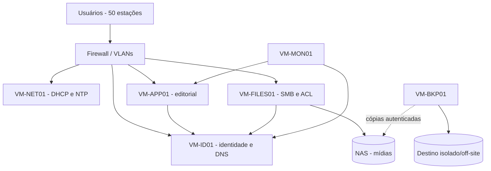

# DF-SO-002 — Catálogo de serviços e compatibilidade
**Revisão:** 1.0 | **Situação:** planejamento; não implantado. Complementa [DF-SO-001](PLANO-SERVICOS-SEGURANCA.md).

## Sistemas por perfil
| Perfil | Qtde | Sistema escolhido | Aplicações previstas | Conferência de compatibilidade |
|---|---:|---|---|---|
| ADM | 6 | Windows 11 Pro 64 bits, release corporativa a homologar | Suite de produtividade, ERP ou sistema financeiro a selecionar, navegador e vídeo | Exigir TPM 2.0, UEFI/Secure Boot, drivers de chipset, rede e impressora; homologação do ERP |
| OP | 28 | Windows 11 Pro 64 bits, release corporativa a homologar | Navegadores, editor de texto, BI, plataforma de publicação, suporte e ferramentas TI | Drivers, navegador, autenticação, 32 GB DDR4 e políticas corporativas; testar aplicações legadas |
| ESP | 16 | Windows 11 Pro 64 bits, release corporativa a homologar | Edição e composição audiovisual, áudio, design | Homologar a versão concreta dos programas; codecs, GPU RTX 4060 8 GB, drivers Studio, aceleração e monitores |
| Host de VMs | 1 | Hipervisor a homologar (produto, versão, assinatura e suporte pendentes) | Infraestrutura de VMs | Verificar HCL do fabricante, CPU com virtualização habilitada, ECC, NICs 10GbE, storage e backup |
| VMs | 6 | Ubuntu Server 24.04 LTS 64 bits (imagem e patchlevel a registrar) | Serviços internos listados abaixo | Validar integração SMB/LDAP/DNS, drivers virtuais e suporte de longo prazo |

**Observação:** 'Windows 11 Pro' e 'Ubuntu Server 24.04 LTS' são escolhas de produto/edição; release exata do Windows, SKU de licença, sistema de identidade e hipervisor estão em aberto e impedem considerar esta matriz homologada. Não pressupor que Microsoft 365, Adobe e DaVinci tenham sido adquiridos. Guardar requisitos oficiais das versões escolhidas.

## Catálogo das VMs
| ID | Função | vCPU | RAM | Disco inicial | Dependências | Rede proposta |
|---|---|---:|---:|---:|---|---|
| VM-ID01 | Identidade/LDAP-Kerberos, DNS interno | 2 | 8 GB | 100 GB | Horário confiável; backups de diretório | VLAN servidores |
| VM-NET01 | DHCP, NTP, registro técnico | 2 | 4 GB | 80 GB | Switches e relay DHCP | VLAN servidores |
| VM-FILES01 | Controle SMB/ACL para compartilhamentos NAS | 4 | 16 GB | 160 GB | NAS, ID/DNS, link 10GbE | VLAN servidores |
| VM-APP01 | Painel interno e fluxo editorial | 4 | 16 GB | 160 GB | Banco a especificar, ID/DNS | VLAN servidores |
| VM-MON01 | Monitoramento e syslog | 2 | 8 GB | 160 GB | Agentes e logs de firewall/switches | VLAN servidores |
| VM-BKP01 | Catálogo, agentes e orquestração de backups | 2 | 8 GB | 160 GB | Repositório de backup **independente do NAS de produção** | VLAN servidores |

**Soma prevista:** 16 vCPU, 60 GB RAM, 820 GB de discos virtuais iniciais. Não confundir volume provisionado com consumo efetivo, nem com o NAS de 24 TB úteis nominais. Host de 128 GB RAM oferece 68 GB de diferença aritmética para hipervisor, cache e expansão; validar a reserva real e os picos de uso.

## Projeto de autenticação (decisão ainda requerida)
**Alternativa A:** controlador de domínio Windows Server com Active Directory; revisar arquitetura de VM-ID01, licenças de servidor e CALs, integração com Windows 11 e custos.
**Alternativa B:** Samba Active Directory em Ubuntu Server; confirmar recursos de política de grupo necessários, compatibilidade com clientes, segurança e nível de suporte.
**Não tratar as duas opções como simultaneamente implantadas.** Selecionar uma, atualizar VM-ID01 e documentos, testar login e redefinição de senha em estação piloto.

## Diagrama lógico de dependências

Representação lógica, não desenho de implantação executada.

## Validação mínima antes do aceite
- Checar requisitos oficiais de OS, aplicativos, drivers, TPM e Secure Boot em amostra de cada perfil.
- Registrar produto, edição, versão, arquitetura, licença, URL oficial e resultado de teste.
- Testar autenticação de usuário comum, acesso à pasta permitida e rejeição de acesso indevido.
- Testar DNS, DHCP, serviço web interno, permissões SMB, encaminhamento de logs e alarmes.
- Documentar plano de restauração dos serviços de identidade, dados, aplicações e VM.
