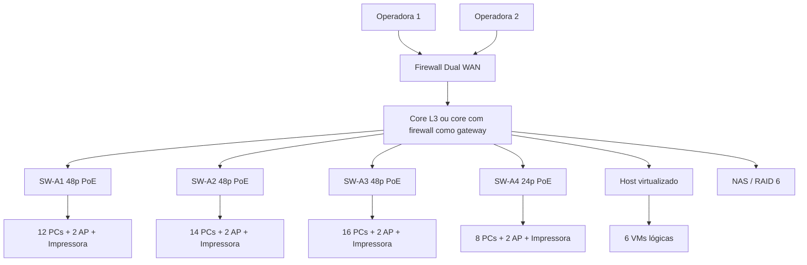

# DF-RED-004 — Especificação de desenho nativo no Cisco Packet Tracer
**Status:** instruções para montagem e aceite; arquivo `.pkt` **não produzido nem testado**.

## Topologia para representar

### Procedimento de montagem
1. Na área lógica do Packet Tracer, desenhar borda WAN, firewall/roteador, core, quatro switches, servidores, oito APs e pelo menos os 50 dispositivos representados por setor.
2. Nomear componentes e as conexões por largura de banda prevista; se Packet Tracer não simular 10Gbps naquele modelo, **indicar a limitação**, sem apresentar velocidade fictícia como medida.
3. Aplicar as VLANs 10–90 e seus endereços conforme DF-RED-002. Representar gateway, DHCP/DNS, ACLs e conexão à Internet. Se apenas desenhar, marcar configuração como conceitual.
4. Associar setores/estações ao andar e a VLAN específica: ADM 6, OP 24, CRIATIVO 16, TI 4.
5. Verificar capacidade de portas, PoE e uplinks com modelos reais escolhidos. Criar legenda com nomes `SW-A1` até `SW-A4`, `CORE`, `FW`, `VM-ID01` etc.
6. Salvar `04_Redes/DarkFrame_topologia.pkt`, fazer captura da topologia, legenda e (se configurado) de DHCP, ping permitido e bloqueio por ACL. Não afirmar teste feito se só existir o desenho.

### Plano de aceitação
| ID | Evidência | Situação |
|---|---|---|
| RED-T01 | Os 4 andares têm postos, APs, rack/switches e legenda | Pendente |
| RED-T02 | Arquivo Packet Tracer abre e apresenta enlaces identificados | Pendente |
| RED-T03 | IPv4 sem IP duplicado e VLANs corretas | Pendente |
| RED-T04 | Visitantes sem acesso à rede interna | Pendente, somente se simulado |
| RED-T05 | IoT separado da administração/financeiro | Pendente, só para IoT de rede opcional |
| RED-T06 | Portas usadas/livres, PoE e orçamento reconciliados | Pendente |

**Aviso:** o sensor obrigatório TMP36/Arduino é circuito Tinkercad local, não dispositivo de rede por padrão; a VLAN60 é previsão de futura ampliação, não evidência de IoT conectado.
