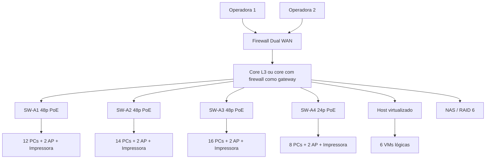

# DF-RED-004 — Especificação de desenho nativo no Cisco Packet Tracer
**Status:** topologia conceitual montada, aberta e salva no Cisco Packet Tracer 9.0.1.

- [Arquivo nativo do Packet Tracer](DarkFrame_topologia.pkt)
- [Captura da topologia completa](evidencias/DarkFrame_topologia.png)

## Evidência da montagem

A área lógica apresenta 77 equipamentos de rede e 76 enlaces. Foram conferidos a abertura do arquivo, a distribuição dos 50 postos, o cabeamento de todos os equipamentos e os indicadores de enlace após a convergência.

| Andar | Estações | VLANs previstas para os postos | Uplink no simulador |
|---|---|---|---|
| 1º | `PT-A1-001` a `PT-A1-012` | VLAN 10 para recepção (2) e VLAN 20 para publicação e suporte (10) | `CORE-DF Fa0/1` ↔ `SW-A1 Fa0/24` |
| 2º | `PT-A2-001` a `PT-A2-014` | VLAN 20 para roteirização e pesquisa (14) | `CORE-DF Fa0/2` ↔ `SW-A2 Fa0/24` |
| 3º | `PT-A3-001` a `PT-A3-016` | VLAN 30 para edição, design e áudio (16) | `CORE-DF Fa0/3` ↔ `SW-A3 Fa0/24` |
| 4º | `PT-A4-001` a `PT-A4-008` | VLAN 40 para TI (4) e VLAN 10 para financeiro, RH e diretoria (4) | `CORE-DF Fa0/4` ↔ `SW-A4 Fa0/24` |

Cada switch de andar conecta os PCs em ordem a partir de `Fa0/1`, os dois APs em `Fa0/17` e `Fa0/19` e a impressora em `Fa0/18`. No núcleo, `Fa0/5–10` atendem às seis VMs, `Fa0/11` ao NAS e `Fa0/12` ao roteador de borda. O `RTR-EDGE` conecta o núcleo em `Gi0/0` e as operadoras em `Gi0/1–2`.

Os uplinks do simulador usam cobre FastEthernet. A fibra de 10 Gb/s permanece como referência do projeto físico. O NAS é representado por um Server-PT, e o roteador de borda representa o equipamento Dual WAN previsto. As VLANs 10–90 e o endereçamento são conceituais. DHCP, DNS, ACLs, roteamento e testes de tráfego permanecem no roteiro de configuração opcional.

## Topologia para representar

### Procedimento de montagem
1. Na área lógica do Packet Tracer, desenhar borda WAN, firewall/roteador, core, quatro switches, servidores, oito APs e pelo menos os 50 dispositivos representados por setor.
2. Nomear componentes e as conexões por largura de banda prevista; se Packet Tracer não simular 10Gbps naquele modelo, **indicar a limitação**, sem apresentar velocidade fictícia como medida.
3. Aplicar as VLANs 10–90 e seus endereços conforme DF-RED-002. Representar gateway, DHCP/DNS, ACLs e conexão à Internet. Se apenas desenhar, marcar configuração como conceitual.
4. Associar setores/estações ao andar e a VLAN específica: ADM 6, OP 24, CRIATIVO 16, TI 4.
5. Verificar capacidade de portas, PoE e uplinks com modelos reais escolhidos. Criar legenda com nomes `SW-A1` até `SW-A4`, `CORE`, `FW`, `VM-ID01` etc.
6. Salvar `04_Redes/DarkFrame_topologia.pkt`, fazer captura da topologia, legenda e (se configurado) de DHCP, ping permitido e bloqueio por ACL. Não afirmar teste feito se só existir o desenho.

### Plano de aceitação
| ID | Evidência | Situação |
|---|---|---|
| RED-T01 | Os 4 andares têm postos, APs, rack/switches e legenda | Conferido na área lógica e na captura |
| RED-T02 | Arquivo Packet Tracer abre e apresenta enlaces identificados | Conferido no Packet Tracer 9.0.1 |
| RED-T03 | IPv4 sem IP duplicado e VLANs corretas | Pendente |
| RED-T04 | Visitantes sem acesso à rede interna | Pendente, somente se simulado |
| RED-T05 | IoT separado da administração/financeiro | Pendente, só para IoT de rede opcional |
| RED-T06 | Portas usadas/livres, PoE e orçamento reconciliados | Pendente |

**Aviso:** o sensor obrigatório TMP36/Arduino é circuito Tinkercad local, não dispositivo de rede por padrão; a VLAN60 é previsão de futura ampliação, não evidência de IoT conectado.
