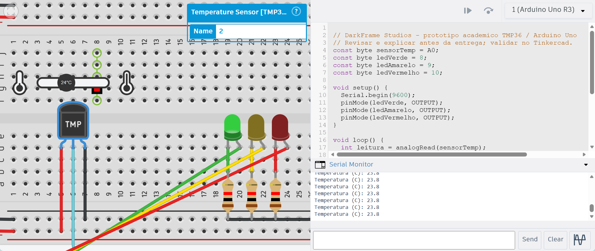
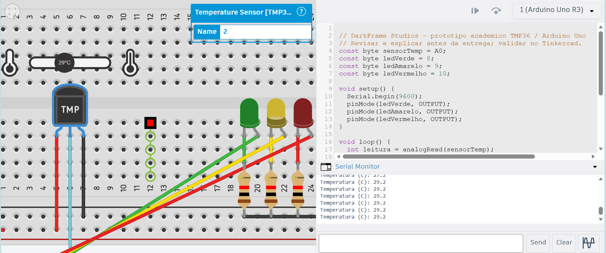
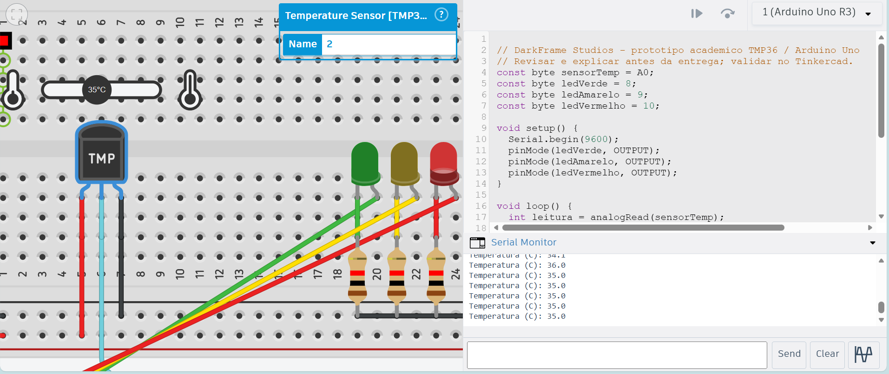

# Monitor de temperatura TMP36 — Protocolo de verificação

A implementação do código está em [monitor_tmp36.ino](monitor_tmp36.ino). O memorial de conexões e o cálculo de temperatura estão em [DF-IOT-002](MEMORIAL-IOT-TMP36.md).

## 1. Objetivo

Validar o funcionamento do sistema de monitoramento de temperatura desenvolvido para o projeto acadêmico DarkFrame Studios, utilizando Arduino Uno R3, sensor TMP36 e três LEDs indicadores.

Os testes foram realizados no simulador Tinkercad, considerando três cenários de temperatura: 24 °C, 29 °C e 35 °C.

## 2. Critérios de funcionamento

- **LED verde:** temperatura inferior a 28 °C — condição normal.
- **LED amarelo:** temperatura igual ou superior a 28 °C e inferior a 32 °C — condição de atenção.
- **LED vermelho:** temperatura igual ou superior a 32 °C — condição de alerta.

## 3. Resultados dos testes

| Temperatura configurada | Verde esperado | Amarelo esperado | Vermelho esperado | Resultado medido | Evidência | Aprovado/Reprovado |
|---|---|---|---|---|---|---|
| 24 °C | Aceso | Apagado | Apagado | 23,8 °C | [Teste 24 °C](evidencias/teste-24c.png) | Aprovado |
| 29 °C | Apagado | Aceso | Apagado | 29,2 °C | [Teste 29 °C](evidencias/teste-29c.png) | Aprovado |
| 35 °C | Apagado | Apagado | Aceso | 35,0 °C | [Teste 35 °C](evidencias/teste-35c.png) | Aprovado |

## 4. Evidências das simulações

### Teste 1 — Temperatura de 24 °C

O sensor TMP36 foi configurado para 24 °C. O Monitor Serial registrou 23,8 °C, com o LED verde aceso e os demais apagados.

**Resultado:** Aprovado.

### Teste 2 — Temperatura de 29 °C

O sensor TMP36 foi configurado para 29 °C. O Monitor Serial registrou 29,2 °C, com o LED amarelo aceso e os demais apagados.

**Resultado:** Aprovado.

### Teste 3 — Temperatura de 35 °C

O sensor TMP36 foi configurado para 35 °C. O Monitor Serial registrou 35,0 °C, com o LED vermelho aceso e os demais apagados.

**Resultado:** Aprovado.

## 5. Simulação no Tinkercad

O circuito completo pode ser consultado pelo link:

[DarkFrame — Monitor TMP36 no Tinkercad](https://www.tinkercad.com/things/9YpYYnOT4nK-darkframe-monitor-tmp36?sharecode=IinUTfr2kZB4kWGQIVWQxDl-odx-CBLEJG6nf4tWruU)

## 6. Conclusão

Os três cenários de temperatura foram executados no ambiente de simulação Tinkercad.

O sistema apresentou o comportamento esperado nos testes, acionando o LED correspondente à faixa de temperatura identificada e exibindo os valores calculados no Monitor Serial.

As diferenças entre as temperaturas configuradas e medidas foram de 0,2 °C, 0,2 °C e 0,0 °C, respectivamente.

Dessa forma, o protótipo foi validado em ambiente simulado para os três cenários definidos no protocolo.

**Observação:** os resultados apresentados referem-se exclusivamente à simulação no Tinkercad, não constituindo validação em hardware físico.
